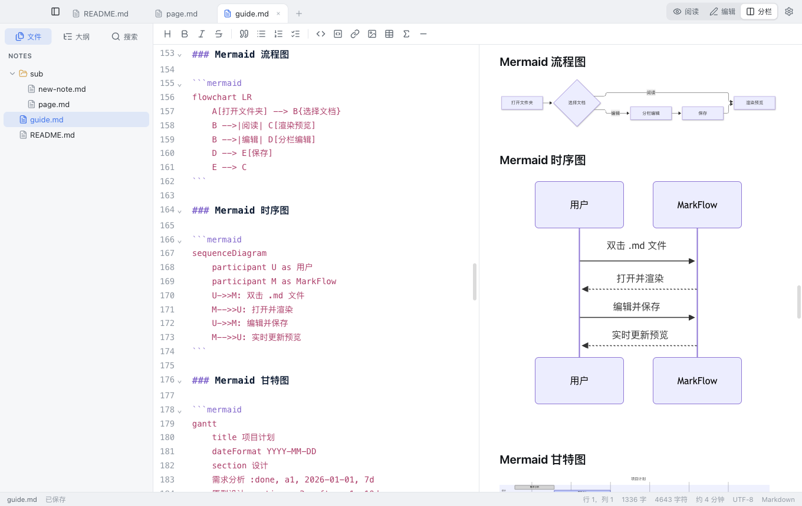

# MarkFlow

跨平台（macOS / Windows / Linux）的 Markdown 阅读与编辑工具：打开文件夹按目录浏览文档，阅读 / 编辑 / 分栏三种视图，完整的 Markdown 语法与公式、图表等高级特性渲染，并注册为系统的 Markdown “打开方式”。也能打开任何文本和代码文件（语法高亮、保留原编码与换行符），二进制文件显示其类型图标。



## 功能

**阅读与编辑**

- 三种视图：阅读（渲染预览）、编辑（源码）、分栏（左右实时预览，双向同步滚动）
- **阅读模式下直接编辑**：双击任意内容块，或点悬停工具栏上的铅笔按钮，就会在原位置打开这一块的 Markdown 源码进行编辑；按 Esc 或 ⌘/Ctrl+Enter 完成，点“取消”放弃修改。文末的“添加内容”可以追加新内容。阅读模式下也能用 ⌘/Ctrl+Z 撤销。双击编辑可在「设置 → 预览」中关闭
- **单块源码**：悬停工具栏上的 `</>` 按钮可把任意一块切换成高亮显示的 Markdown 源码，再点一次恢复渲染；打印和导出始终使用渲染结果
- **图形放大查看**：点击 Mermaid / Graphviz / ECharts / PlantUML 图表或图片，打开全屏查看器。支持滚轮缩放、拖动平移、双击放大或还原、适应窗口、1:1 原始大小，图表可导出为 SVG
- CodeMirror 6 编辑器：Markdown 语法高亮、代码块内多语言高亮、列表自动续写、查找替换、多光标
- **查找与替换**：悬浮在编辑区右上角的查找面板，跟随浅色 / 深色主题，显示匹配数（如 `3/120`），支持区分大小写、全字匹配、正则和选中全部结果，替换行可折叠。输入时自动跳到第一个结果（中文输入法选词完成后才搜索），结果滚动到视图中央；当前结果以橙色实底突出，并有放大回弹效果，其余结果为黄色。阅读模式的查找栏外观和效果相同。大文档只在按回车时跳转，匹配数在后台分片统计，不会卡住界面
- 格式工具栏与快捷键：加粗、斜体、标题、引用、列表、任务、代码块、表格、公式…
- **Sublime Text 风格快捷键**：多光标（⌘D 选中下一个、⇧⌘L 拆分多行、⌃⇧↑/↓ 加光标）、行操作（⇧⌘D 复制行、⌃⌘↑/↓ 移动行、⌘J 合并行、⌃⇧K 删除行）、`⌘K` 组合键（⌘K ⌘U 大写、⌘K ⌘1–9 按标题级别折叠…）、命令面板（⇧⌘P）、Goto Anything（⌘P，支持 `文件:行号`、`@标题`、`#文件夹内标题`）、⌘R 跳转到标题、⌃G 跳转到行、书签（⌘F2 / F2）、跳回 / 前进（⌃- / ⌃⇧-）、⌘1–9 切换标签页、专注模式（⌃⇧⌘F）。Windows / Linux 使用 Sublime 对应的 Ctrl / Alt 键位，完整列表见 [docs/shortcuts.md](docs/shortcuts.md)
- 粘贴 / 拖入图片自动保存到文档旁的 `assets/` 目录并插入相对链接
- **从 Excel / Numbers / WPS / Google 表格复制的单元格粘贴为 Markdown 表格**（第一行作表头，数字列右对齐，单元格内换行转为 `<br>`，合并单元格展开）；只复制一个单元格时粘贴其值。从 Word 或网页复制的富文本粘贴为文字，而不是它附带的截图；只有剪贴板里确实只有图片时才按图片粘贴。想要原始的制表符文本可用 ⇧⌘V（粘贴并匹配缩进）
- 在阅读模式中直接点击任务列表复选框即可修改源文件
- 多标签页、未保存提示、自动保存（可选）、文件被外部修改时自动重载或提示
- **崩溃恢复**：新建或修改后尚未保存的内容会实时备份（停止输入约 0.7 秒后写入）。程序崩溃、被强制结束或断电后再次打开，这些文档会以“未保存”状态自动恢复。如果期间磁盘上的文件被别处修改过，会提示冲突，由你选择保留哪个版本。关闭窗口或退出时如有未保存的文档，除了“保存”和“不保存”，还可以选择 **“暂存”**：修改不写入文件，下次打开 MarkFlow 时以“未保存”状态原样恢复（macOS 上关闭最后一个窗口后程序仍在运行，再打开的新窗口也会恢复）。超大文件无法备份，有这类文档未保存时不提供“暂存”。正常保存，或选择“不保存”，都会删除对应备份
- 导出 HTML（含已渲染的图表）、导出 PDF、打印

**任意文件**

- **任何文本文件都能打开和编辑**，与扩展名无关（`.log`、`.conf`、`Dockerfile`、无扩展名的脚本…）：打开时读取文件开头判断是否为文本
- **新建文档可设置类型**：新建的文档默认是 Markdown，点状态栏右下角的类型名（或右键标签页、在命令面板输入“设置文档类型”）可改为纯文本、HTML、JavaScript 等 140 多种类型；内容和撤销历史都保留，标签名、语法高亮和保存时建议的扩展名随之变化。保存后以文件名为准（选了 HTML 却存成 `.md`，就是 Markdown 文档）
- **代码语法高亮**：140 多种语言（TypeScript、Python、Go、Rust、Java、C/C++、Shell、SQL、YAML、JSON、Dockerfile、Nginx…），按文件名、常见文件名（`Makefile`、`.bashrc`、`Gemfile`…）和首行 `#!` 自动识别；点状态栏的语言名或在命令面板输入“设置语法”可手动切换。代码文件里 Markdown 格式快捷键（⌘B 等）不生效，⌘/ 按该语言的注释语法切换注释
- **编码与换行符**：自动识别 UTF-8、UTF-8 BOM、UTF-16 LE/BE、GB18030（GBK）、Big5、Shift_JIS、EUC-KR、Windows-1252，并保留 LF / CRLF；保存时沿用原编码和换行符。点状态栏的编码可“通过编码重新打开”或“通过编码保存”（例如把 GBK 文件转为 UTF-8），点 LF / CRLF 可切换换行符。若内容中有原编码无法表示的字符，会询问是否改用 UTF-8 保存，不会静默丢字
- **大文件**（16 MB 以上，最大 1 GB，参考 Sublime 的做法）：文件分块读取、解码后直接变成编辑器的行，界面显示打开进度，可随时取消；不会出现一份完整的大字符串，也不会在界面状态里再存一份副本。纯 ASCII / 拉丁字符的行按单字节存储，只有含中文等宽字符的行才占双字节，内存约为文件大小的 1.5 倍（250 MB 的 SQL 导出约 1 秒打开、占用约 360 MB）。编辑时不再每次按键都复制整篇文本；保存时分块写入临时文件再替换原文件，保留原编码和换行符。大文件模式下关闭预览、字数统计、崩溃备份、自动保存和自动换行（超长行只绘制可见部分），默认不做语法高亮（可在状态栏手动选择语法）；文件在外部被修改时按修改时间判断并重新载入
- **二进制文件**（压缩包、PDF、音视频、字体、可执行文件…）在中间显示系统的文件类型图标、类型、大小和修改时间，可“用默认应用打开”或在访达 / 资源管理器中显示；内容被误判为二进制时可“仍以文本方式打开”
- 文件树标题栏的眼睛按钮可在“只显示 Markdown”和“显示所有文件”之间切换；显示所有文件时，文件夹搜索也会搜索其中的文本文件

**文件夹工作区**

- 打开文件夹后在侧边栏以目录树浏览（默认只显示 Markdown 文件，可切换显示全部）
- 新建 / 重命名 / 删除（移到废纸篓）、在访达 / 资源管理器中显示、复制路径
- 文件夹实时监听：增删文件自动刷新。macOS / Windows 上整个文件夹只用一个系统原生的递归监听（FSEvents / ReadDirectoryChangesW），几千个子目录的大文件夹也能秒开、秒关；Linux 使用 inotify
- 大纲面板（当前标题高亮）、全文搜索（大小写 / 全字 / 正则）、快速打开 / Goto Anything（⌘P / Ctrl+P）
- 相对链接、`[[双链]]`、`![[图片嵌入]]` 在应用内直接跳转
- 启动时恢复上次的文件夹和标签页

**渲染支持的语法**

| 类别 | 内容 |
| --- | --- |
| CommonMark | 标题、段落、强调、引用、列表、代码、链接、图片、分割线、HTML |
| GFM | 表格（对齐）、删除线、任务列表、自动链接、脚注、提示块 `> [!NOTE]` |
| 数学 | KaTeX：`$…$`、`$$…$$`、```` ```math ````，含 mhchem 化学式 `\ce{}` |
| 图表 | Mermaid（流程图 / 时序图 / 甘特图 / 类图…）、Graphviz（dot）、ECharts、PlantUML（可选，联网） |
| 扩展 | Emoji `:smile:`、上标 `^x^`、下标 `~x~`、高亮 `==x==`、插入 `++x++`、缩写、定义列表、自定义容器 `::: tip`、属性 `{#id .class width=200}`、标题锚点、`[TOC]` 目录、YAML Front Matter |
| 代码 | highlight.js 190+ 种语言高亮、一键复制 |

完整示例见应用内「帮助 → Markdown 语法示例」或 [docs/markdown-guide.zh-CN.md](docs/markdown-guide.zh-CN.md)。

## 系统“打开方式”注册

| 平台 | 注册内容 |
| --- | --- |
| macOS | `CFBundleDocumentTypes` 声明 `net.daringfireball.markdown` 及 `.md/.markdown/.mdown/.mkd/.mdx…`；另以 `Alternate` 级别声明 `public.text` / `public.source-code` 等，所有文本和代码文件的“打开方式”里都能看到 MarkFlow，但不会成为它们的默认应用；可把文件夹拖到 Dock 图标上打开 |
| Windows | NSIS 安装程序注册 Markdown 的 ProgID 与“打开方式”，并在文件夹和文件的右键菜单添加 “Open with MarkFlow” |
| Linux | `.desktop` 文件声明 `MimeType=text/markdown;text/x-markdown;text/plain;application/json;…`（deb 安装后生效） |

在「设置 → 通用 → 文件关联」中可一键设为默认 Markdown 应用（macOS 直接设置；Windows 会打开系统“默认应用”页面；Linux 调用 `xdg-mime`）。

应用为单实例：再次双击文件会在已打开的窗口中以新标签打开；打开另一个文件夹会新开窗口。

## 开发

需要 Node.js ≥ 22。

```bash
npm install          # 若 npm 未执行依赖的安装脚本，postinstall 会自动下载 Electron
npm run dev          # 开发模式（热更新）
npm run typecheck    # 类型检查
npm run test:md      # Markdown 渲染单元测试
npm run test:e2e     # 端到端测试（Playwright 驱动真实应用，截图输出到 tests/output/）
npm run test:update  # 增量更新端到端测试（需先 `npx electron-builder --mac --dir`，驱动打包后的应用）
npm run test:recovery  # 崩溃恢复端到端测试（编辑中途强制结束进程，再检查恢复结果）
npm run test:reading   # 阅读模式端到端测试（块编辑、单块源码、图形放大查看）
npm run test:keys      # 快捷键单元测试（键位注册表、编辑命令、标题解析、面板解析）
npm run test:text      # 文本文件单元测试（二进制判断、编码识别与往返、换行符、语法识别）
npm run test:watch     # 文件夹监听单元测试（大文件夹只占一个句柄、关闭耗时、增删改事件、忽略目录）
npm run test:shortcuts # 快捷键端到端测试（真实按键、⌘K 组合键、菜单、命令面板、书签、跳回、专注模式）
npm run test:files     # 任意文件端到端测试（代码高亮、GB18030 / UTF-16 / CRLF 保存、二进制文件视图）
npm run test:large     # 大文件夹端到端测试（2000 个子目录：监听句柄数、目录树更新、退出耗时）
npm run test:paste     # 表格粘贴单元测试（制表符文本解析、Markdown 表格生成）
npm run test:paste-e2e # 表格粘贴端到端测试（Excel / Google 表格 / Word / 网页 / 图片 / 代码文件 / 块编辑器）
npm run test:find      # 查找端到端测试（面板样式、匹配数、边输边跳、居中、高亮与放大、替换、深色主题、阅读模式）
npm run test:largefile # 大文件单元测试（分块解码与换行符、编码中途回退、分块写入、单字节分段）
node tests/large-file-e2e.mjs # 大文件端到端测试（约 250 MB 的 SQL：打开耗时、内存、跳转、超长行、编辑保存、外部修改）
npm run docs:shortcuts # 根据 src/shared/keybindings.ts 重新生成 docs/shortcuts*.md 和 README / 指南里的快捷键表
```

国内网络可在 `~/.npmrc` 中设置 `electron_mirror=https://npmmirror.com/mirrors/electron/`。

## 打包

```bash
npm run dist:mac     # .dmg + .zip（arm64 / x64）
npm run dist:win     # NSIS 安装包 + 便携 zip（x64 / arm64）
npm run dist:linux   # AppImage + deb + tar.gz
```

产物位于 `release/<版本号>/`。NSIS、AppImage、deb 的打包工具是 x86 程序，请在对应平台（或 Apple Silicon 上安装 Rosetta）构建；仓库已附带 GitHub Actions 工作流 [.github/workflows/build.yml](.github/workflows/build.yml)，推送 `v*` 标签即可在三个平台原生构建。

未配置签名证书时，macOS 安装包未签名，从网络下载后首次打开需在“系统设置 → 隐私与安全性”中允许，或执行 `xattr -cr /Applications/MarkFlow.app`。

## 自动更新（增量）

安装包约 130 MB，其中 Electron 运行时占了绝大部分，而且基本不变；应用自身代码压缩后只有约 4 MB，并拆成 280 个左右的独立文件。因此更新分两种：

| 类型 | 何时使用 | 下载量 |
| --- | --- | --- |
| **增量更新** | Electron 版本没变（绝大多数版本） | 只下载内容有变化的文件。实测只改业务代码时约 **30–40 KB** |
| 完整更新 | 升级了 Electron 运行时 | 下载对应平台的安装包（DMG / NSIS / AppImage），由用户安装 |

**工作原理**

- `src/bootstrap/` 是安装包里唯一不会被热更新替换的引导程序。启动时它检查 `<用户数据>/updates/state.json`，如果有更新、兼容且没被标记为失败的版本，就加载 `updates/<版本>/out/main/index.js`，否则加载安装包自带的代码。
- 更新器（`src/main/updater.ts`）每 6 小时检查一次 `latest.json`。先用内置的 Ed25519 公钥校验签名，再逐个文件比对哈希：本地已有的文件直接复制，其余文件从 `files/<sha256>.gz` 下载。全部解压并校验后，才原子地切换到新版本，下次启动生效（也可以点"重启并更新"）。
- **回滚保护**：新版本加载时出错，或连续两次没能完成启动，引导程序会把它标记为失败，自动回到安装包自带的版本，之后也不会再下载这个版本。
- 渲染层的 chunk 使用固定文件名，第三方库拆分到独立的 `vendor-*.js`，所以改一处代码只会影响一个文件，不会连带改动其他文件。

**发布流程**

```bash
npm run update:keygen      # 只需一次：生成签名密钥，私钥在 keys/（已忽略，请务必备份）
npm run dist:mac           # 等平台安装包（可选，用于需要完整更新的情况）
npm run build
npm run release:update -- --notes "修复了……"
```

生成的 `release/update/` 是一个纯静态目录，用部署脚本上传到更新服务器（脚本会先上传内容、最后上传 `latest.json`），再用校验脚本检查：

```bash
npm run deploy:update -- deploy@updates.example.com:/opt/markflow-update/data   # 或本地目录 / 挂载点
npm run verify:update -- https://updates.example.com/markflow/
```

**更新服务器的要求和四种部署方式**（Docker + Caddy 自动 HTTPS、已有 nginx、对象存储 + CDN、Node + systemd）见 [docs/update-server.md](docs/update-server.md)。对应的配置文件都在 [server/](server) 目录下。

更新地址在 `package.json` 的 `"markflow": { "updateUrl": "https://你的域名/markflow/" }` 中配置，也可以在应用的「设置 → 更新」里修改。CI 工作流中的 `update-feed` 任务会自动生成这个目录，需要把私钥配置为 `MARKFLOW_UPDATE_KEY` 仓库密钥。

> 私钥一旦丢失，已安装的客户端就无法再验证新的更新，只能重新分发安装包。

## 目录结构

```
src/
  bootstrap/   启动引导：选择运行安装包自带的代码还是增量更新后的代码
  main/        Electron 主进程：窗口、菜单、IPC、文件监听、文件关联、本地资源协议、更新器
  preload/     安全的 contextBridge API
  shared/      主进程与渲染进程共享的类型、常量、多语言文案
  renderer/    React 界面
    src/markdown/   Markdown 渲染管线（markdown-it 插件、净化、图表）
    src/editor/     CodeMirror 配置与格式化命令
    src/components/ 侧边栏、标签页、编辑器、预览、设置等
build/         图标与安装包资源（electron-builder）
scripts/       图标生成、发布 / 部署 / 校验增量更新、生成签名密钥
server/        更新服务器：Docker + Caddy、nginx 配置、Node 静态服务器、systemd 单元
docs/          内置的语法示例文档
tests/         单元测试与端到端测试
```

## 快捷键

<!-- shortcuts:start -->
| 命令 | macOS | Windows / Linux |
| --- | --- | --- |
| 快速打开… | ⌘P | Ctrl+P |
| 命令面板… | ⇧⌘P | Ctrl+Shift+P |
| 跳转到标题… | ⌘R | Ctrl+R |
| 跳转到行… | ⌃G | Ctrl+G |
| 在文件夹中搜索 | ⇧⌘F | Ctrl+Shift+F |
| 查找 | ⌘F | Ctrl+F |
| 替换… | ⌥⌘F | Ctrl+H |
| 保存 | ⌘S | Ctrl+S |
| 切换阅读/编辑 | ⌥⌘E | Ctrl+Alt+E |
| 阅读模式 | ⌥⌘1 | Ctrl+Alt+1 或 Alt+Shift+1 |
| 编辑模式 | ⌥⌘2 | Ctrl+Alt+2 或 Alt+Shift+2 |
| 分栏模式 | ⌥⌘3 | Ctrl+Alt+3 或 Alt+Shift+3 |
| 切换侧边栏 | ⌘\\ 或 ⌘K ⌘B | Ctrl+\\ 或 Ctrl+K Ctrl+B |
| 专注模式 | ⌃⇧⌘F | Shift+F11 |
| 加粗 | ⌘B | Ctrl+B |
| 斜体 | ⌘I | Ctrl+I |
| 超链接 | ⌥⌘K | Ctrl+Alt+K |
| 行内代码 | ⌃\` | Ctrl+\` |
| 标题 1–6 | ⌃⌘1 … ⌃⌘6 | Ctrl+1 … Ctrl+6 |
| 选中下一个相同项 | ⌘D | Ctrl+D |
| 拆分为多行光标 | ⇧⌘L | Ctrl+Shift+L |
| 复制行 / 选区 | ⇧⌘D | Ctrl+Shift+D |
| 上移行 | ⌃⌘↑ | Ctrl+Shift+Up |
| 下移行 | ⌃⌘↓ | Ctrl+Shift+Down |
| 切换注释 | ⌘/ | Ctrl+/ |
| 转为大写 | ⌘K ⌘U | Ctrl+K Ctrl+U |
| 后退 | ⌃- | Alt+- |
| 添加 / 取消书签 | ⌘F2 | Ctrl+F2 |
| 下一个标签页 | ⌥⌘→ 或 ⇧⌘\] 或 ⌃⇥ | Ctrl+PageDown 或 Ctrl+Tab |

完整列表见 [docs/shortcuts.md](docs/shortcuts.md)，也可以按 ⇧⌘P / Ctrl+Shift+P 打开命令面板查看。
<!-- shortcuts:end -->

## 许可

MIT
