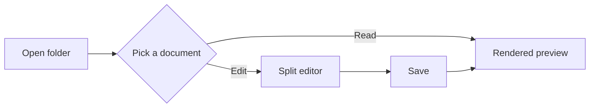
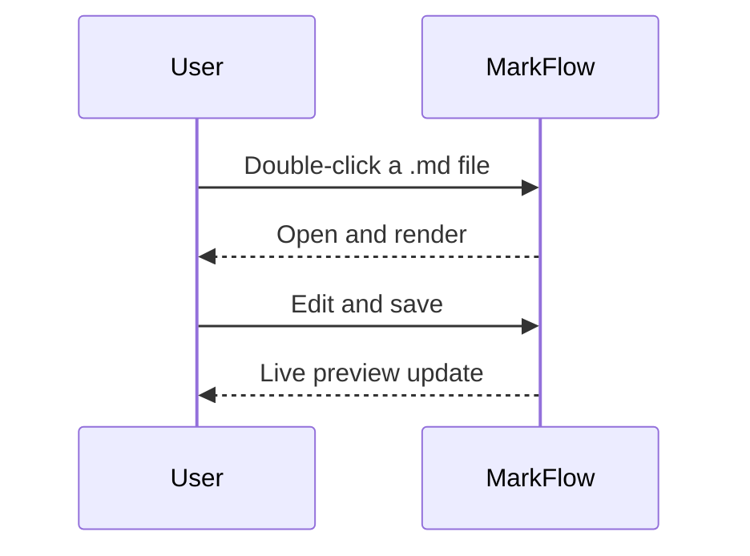
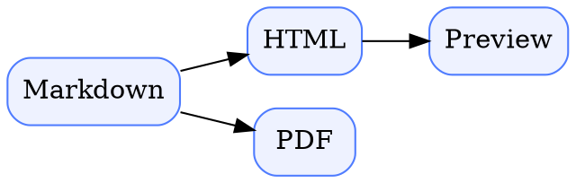
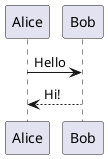

# Markdown Syntax Guide

This document showcases every syntax MarkFlow supports. Switch to **Edit** or **Split** mode to see the source.

[TOC]

## Basics

### Headings

Use `#` to `######` for heading levels 1–6. You can also give a heading an id: `## Title {#my-id}`.

### Paragraphs and line breaks

Separate paragraphs with a blank line. End a line with two spaces  
or a backslash\
to force a line break.

### Emphasis

*Italic* or _italic_, **bold** or __bold__, ***bold italic***, ~~strikethrough~~, ==highlight==, ++inserted++.

Superscript: x^2^, subscript: H~2~O, keys: <kbd>Ctrl</kbd> + <kbd>C</kbd>.

### Blockquotes

> Quotes can be nested:
>
> > This is the second level.
>
> They can contain **other syntax** too.

### Lists

- Bulleted item
- Another item
  - Nested item
  - One more
    1. Mixed numbered list
    2. Second item

1. Numbered list
2. Second item
3. Third item

### Task lists

- [x] Completed task
- [ ] Open task (click the checkbox in reading mode to toggle it)
- [ ] Nesting works
  - [x] Sub-task

### Links and images

- Inline link: [MarkFlow](https://github.com)
- With title: [CommonMark](https://commonmark.org "CommonMark spec")
- Autolinks: <https://spec.commonmark.org> and https://github.github.com/gfm/
- Reference link: [GFM spec][gfm]
- In-document jump: [go to tables](#tables)
- Relative links such as `[Other](./notes/other.md)` open inside MarkFlow
- Wikilinks: `[[Page]]`, `[[Page|Label]]`, `[[Page#Heading]]` look up documents in the open folder

[gfm]: https://github.github.com/gfm/

Images may use relative paths, absolute paths or URLs, with optional sizing:

```markdown

{width=300}
![[images/photo.png|300]]
```


### Horizontal rule

---

## Code

Inline code: `const answer = 42`.

```typescript
// Syntax highlighting for 190+ languages; hover to copy
interface User {
  id: number
  name: string
}

export function greet(user: User): string {
  return `Hello, ${user.name}!`
}
```

```python
def fib(n: int) -> int:
    return n if n < 2 else fib(n - 1) + fib(n - 2)

print([fib(i) for i in range(10)])
```

```diff
- const color = 'red'
+ const color = 'blue'
```

    Indenting with four spaces also makes a code block

## Tables

| Left | Center | Right |
| :--- | :----: | ----: |
| Apple | 🍎 | $3.50 |
| Banana | 🍌 | $2.00 |
| Watermelon | 🍉 | $12.80 |

## Math

Inline math: $E = mc^2$ and $\sum_{i=1}^{n} i = \frac{n(n+1)}{2}$.

Display math:

$$
\int_{-\infty}^{\infty} e^{-x^2}\,dx = \sqrt{\pi}
$$

$$
\begin{aligned}
\nabla \cdot \mathbf{E} &= \frac{\rho}{\varepsilon_0} \\
\nabla \times \mathbf{B} &= \mu_0 \mathbf{J} + \mu_0 \varepsilon_0 \frac{\partial \mathbf{E}}{\partial t}
\end{aligned}
$$

Matrices and chemistry (mhchem):

```math
\begin{pmatrix} a & b \\ c & d \end{pmatrix}
\begin{pmatrix} x \\ y \end{pmatrix} =
\begin{pmatrix} ax + by \\ cx + dy \end{pmatrix}
```

$\ce{2H2 + O2 -> 2H2O}$, $\ce{CO2 + C -> 2CO}$

## Diagrams

### Mermaid flowchart



### Mermaid sequence diagram



### Graphviz



### ECharts

```echarts
{
  "tooltip": {},
  "xAxis": { "type": "category", "data": ["Mon", "Tue", "Wed", "Thu", "Fri", "Sat", "Sun"] },
  "yAxis": { "type": "value" },
  "series": [{ "type": "line", "smooth": true, "data": [120, 200, 150, 80, 70, 110, 130] }]
}
```

### PlantUML

PlantUML needs an online server and is off by default; enable it in Settings → Advanced.



## Extensions

### GitHub alerts

> [!NOTE]
> Useful information that users should know.

> [!TIP]
> Helpful advice for doing things better.

> [!IMPORTANT]
> Key information users need to know.

> [!WARNING]
> Urgent info that needs immediate attention.

> [!CAUTION]
> Advises about risks or negative outcomes.

### Custom containers

::: tip Pro tip
Containers can hold **any Markdown**.
:::

::: warning
This is a warning container.
:::

::: danger Danger zone
Do not run this in production!
:::

::: details Click to expand
Hidden content.
:::

### Footnotes

Here is a footnote reference[^1] and another one[^note].

[^1]: The first footnote.
[^note]: Footnotes can contain **formatting** too.

### Definition lists

Markdown
: A lightweight markup language.

MarkFlow
: A cross-platform Markdown reader and editor.

### Abbreviations

*[HTML]: HyperText Markup Language
*[GFM]: GitHub Flavored Markdown

Hover HTML or GFM to see the expansion.

### Emoji

:smile: :rocket: :tada: :heart: :+1: :warning: :bulb:

### Custom attributes

This paragraph has a custom style. {style="color: #7a5cff"}

### HTML

<details>
<summary>Native HTML disclosure</summary>

You can mix <span style="color: #e5534b">HTML</span> into Markdown.

</details>

<p align="center">A centred paragraph</p>

## Keyboard shortcuts

<!-- shortcuts:start -->
| Command | macOS | Windows / Linux |
| --- | --- | --- |
| Quick Open… | <kbd>⌘P</kbd> | <kbd>Ctrl+P</kbd> |
| Command Palette… | <kbd>⇧⌘P</kbd> | <kbd>Ctrl+Shift+P</kbd> |
| Goto Heading… | <kbd>⌘R</kbd> | <kbd>Ctrl+R</kbd> |
| Goto Line… | <kbd>⌃G</kbd> | <kbd>Ctrl+G</kbd> |
| Search in Folder | <kbd>⇧⌘F</kbd> | <kbd>Ctrl+Shift+F</kbd> |
| Find | <kbd>⌘F</kbd> | <kbd>Ctrl+F</kbd> |
| Replace… | <kbd>⌥⌘F</kbd> | <kbd>Ctrl+H</kbd> |
| Save | <kbd>⌘S</kbd> | <kbd>Ctrl+S</kbd> |
| Toggle Reading/Editing | <kbd>⌥⌘E</kbd> | <kbd>Ctrl+Alt+E</kbd> |
| Reading Mode | <kbd>⌥⌘1</kbd> | <kbd>Ctrl+Alt+1</kbd> or <kbd>Alt+Shift+1</kbd> |
| Editing Mode | <kbd>⌥⌘2</kbd> | <kbd>Ctrl+Alt+2</kbd> or <kbd>Alt+Shift+2</kbd> |
| Split Mode | <kbd>⌥⌘3</kbd> | <kbd>Ctrl+Alt+3</kbd> or <kbd>Alt+Shift+3</kbd> |
| Toggle Sidebar | <kbd>⌘\\</kbd> or <kbd>⌘K ⌘B</kbd> | <kbd>Ctrl+\\</kbd> or <kbd>Ctrl+K Ctrl+B</kbd> |
| Distraction Free Mode | <kbd>⌃⇧⌘F</kbd> | <kbd>Shift+F11</kbd> |
| Bold | <kbd>⌘B</kbd> | <kbd>Ctrl+B</kbd> |
| Italic | <kbd>⌘I</kbd> | <kbd>Ctrl+I</kbd> |
| Link | <kbd>⌥⌘K</kbd> | <kbd>Ctrl+Alt+K</kbd> |
| Inline Code | <kbd>⌃\`</kbd> | <kbd>Ctrl+\`</kbd> |
| Heading 1–6 | <kbd>⌃⌘1 … ⌃⌘6</kbd> | <kbd>Ctrl+1 … Ctrl+6</kbd> |
| Quick Add Next | <kbd>⌘D</kbd> | <kbd>Ctrl+D</kbd> |
| Split into Lines | <kbd>⇧⌘L</kbd> | <kbd>Ctrl+Shift+L</kbd> |
| Duplicate Line / Selection | <kbd>⇧⌘D</kbd> | <kbd>Ctrl+Shift+D</kbd> |
| Swap Line Up | <kbd>⌃⌘↑</kbd> | <kbd>Ctrl+Shift+Up</kbd> |
| Swap Line Down | <kbd>⌃⌘↓</kbd> | <kbd>Ctrl+Shift+Down</kbd> |
| Toggle Comment | <kbd>⌘/</kbd> | <kbd>Ctrl+/</kbd> |
| Convert to Upper Case | <kbd>⌘K ⌘U</kbd> | <kbd>Ctrl+K Ctrl+U</kbd> |
| Jump Back | <kbd>⌃-</kbd> | <kbd>Alt+-</kbd> |
| Toggle Bookmark | <kbd>⌘F2</kbd> | <kbd>Ctrl+F2</kbd> |
| Next Tab | <kbd>⌥⌘→</kbd> or <kbd>⇧⌘\]</kbd> or <kbd>⌃⇥</kbd> | <kbd>Ctrl+PageDown</kbd> or <kbd>Ctrl+Tab</kbd> |

Open the command palette with <kbd>⇧⌘P</kbd> / <kbd>Ctrl+Shift+P</kbd> to see every command with its shortcut.
<!-- shortcuts:end -->
