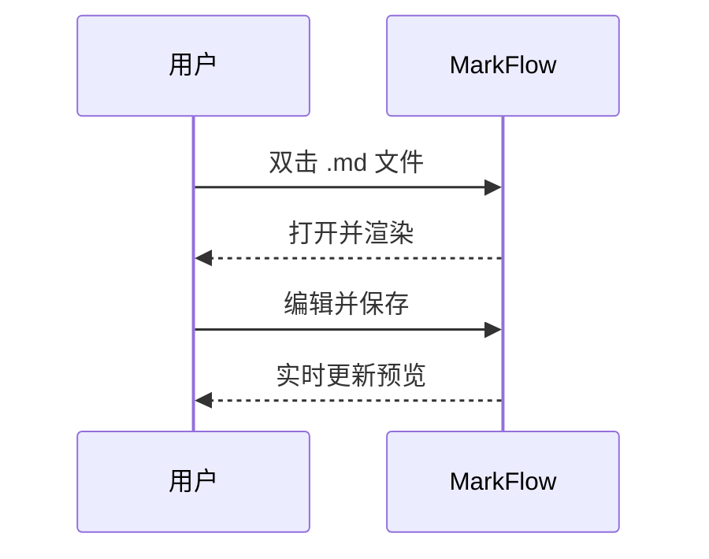
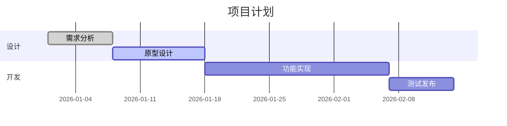
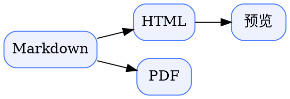
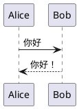

# Markdown 语法示例

这份文档演示了 MarkFlow 支持的全部语法。切换到「编辑」或「分栏」模式即可查看源码。

[TOC]

## 基础语法

### 标题

使用 `#` 到 `######` 表示一到六级标题。也可以给标题指定 ID：`## 标题 {#my-id}`。

### 段落与换行

段落之间用空行分隔。行尾加两个空格  
或使用反斜杠\
可以强制换行。

### 强调

*斜体* 或 _斜体_，**粗体** 或 __粗体__，***粗斜体***，~~删除线~~，==高亮==，++插入文字++。

上标：x^2^，下标：H~2~O，键盘按键：<kbd>Ctrl</kbd> + <kbd>C</kbd>。

### 引用

> 引用可以嵌套：
>
> > 这是第二层引用。
>
> 引用里也可以使用 **其他语法**。

### 列表

- 无序列表项
- 另一项
  - 嵌套项
  - 再一项
    1. 混合有序列表
    2. 第二项

1. 有序列表
2. 第二项
3. 第三项

### 任务列表

- [x] 已完成的任务
- [ ] 未完成的任务（在阅读模式下可以直接点击勾选）
- [ ] 支持嵌套
  - [x] 子任务

### 链接与图片

- 行内链接：[MarkFlow](https://github.com)
- 带标题：[CommonMark](https://commonmark.org "CommonMark 规范")
- 自动链接：<https://spec.commonmark.org> 和 https://github.github.com/gfm/
- 引用式链接：[GFM 规范][gfm]
- 文档内跳转：[跳到表格](#表格)
- 相对路径链接：`[其他文档](./notes/other.md)` 会在 MarkFlow 中直接打开
- 双链：`[[页面名称]]`、`[[页面名称|显示文字]]`、`[[页面#标题]]` 会在当前文件夹中查找同名文档

[gfm]: https://github.github.com/gfm/

图片支持相对路径、绝对路径与网络地址，并可指定尺寸：

```markdown

{width=300}
![[images/photo.png|300]]
```


### 分割线

---

## 代码

行内代码：`const answer = 42`。

```typescript
// 支持 190+ 种语言的语法高亮，悬停可复制
interface User {
  id: number
  name: string
}

export function greet(user: User): string {
  return `Hello, ${user.name}!`
}
```

```python
def fib(n: int) -> int:
    return n if n < 2 else fib(n - 1) + fib(n - 2)

print([fib(i) for i in range(10)])
```

```diff
- const color = 'red'
+ const color = 'blue'
```

    缩进四个空格同样是代码块

## 表格

| 左对齐 | 居中 | 右对齐 |
| :----- | :--: | -----: |
| 苹果   | 🍎   |   ¥3.5 |
| 香蕉   | 🍌   |   ¥2.0 |
| 西瓜   | 🍉   |  ¥12.8 |

## 数学公式

行内公式：$E = mc^2$，以及 $\sum_{i=1}^{n} i = \frac{n(n+1)}{2}$。

块级公式：

$$
\int_{-\infty}^{\infty} e^{-x^2}\,dx = \sqrt{\pi}
$$

$$
\begin{aligned}
\nabla \cdot \mathbf{E} &= \frac{\rho}{\varepsilon_0} \\
\nabla \times \mathbf{B} &= \mu_0 \mathbf{J} + \mu_0 \varepsilon_0 \frac{\partial \mathbf{E}}{\partial t}
\end{aligned}
$$

矩阵与化学方程式（mhchem）：

```math
\begin{pmatrix} a & b \\ c & d \end{pmatrix}
\begin{pmatrix} x \\ y \end{pmatrix} =
\begin{pmatrix} ax + by \\ cx + dy \end{pmatrix}
```

$\ce{2H2 + O2 -> 2H2O}$，$\ce{CO2 + C -> 2CO}$

## 图表

### Mermaid 流程图


### Mermaid 时序图



### Mermaid 甘特图



### Graphviz



### ECharts

```echarts
{
  "tooltip": {},
  "xAxis": { "type": "category", "data": ["周一", "周二", "周三", "周四", "周五", "周六", "周日"] },
  "yAxis": { "type": "value" },
  "series": [{ "type": "bar", "data": [120, 200, 150, 80, 70, 110, 130] }]
}
```

### PlantUML

PlantUML 需要联网渲染，默认关闭，可在「设置 → 高级」中开启。



## 扩展语法

### 提示块（GitHub Alerts）

> [!NOTE]
> 需要读者留意的信息。

> [!TIP]
> 让事情更简单的小技巧。

> [!IMPORTANT]
> 实现目标所必需的关键信息。

> [!WARNING]
> 需要立刻注意的重要内容。

> [!CAUTION]
> 某些操作可能带来的负面后果。

### 自定义容器

::: tip 小贴士
容器内部支持 **任意 Markdown** 语法。
:::

::: warning
这是一个警告容器。
:::

::: danger 危险
请勿在生产环境执行此操作！
:::

::: details 点击展开详情
被折叠的内容。
:::

### 脚注

这里有一个脚注引用[^1]，还有另一个[^note]。

[^1]: 这是第一个脚注。
[^note]: 脚注也可以使用 **格式**。

### 定义列表

Markdown
: 一种轻量级标记语言。

MarkFlow
: 一款跨平台的 Markdown 阅读与编辑工具。

### 缩写

*[HTML]: HyperText Markup Language
*[GFM]: GitHub Flavored Markdown

HTML 与 GFM 上会显示缩写提示（鼠标悬停）。

### Emoji

:smile: :rocket: :tada: :heart: :+1: :warning: :bulb:

### 自定义属性

这一段文字带有自定义样式。{style="color: #7a5cff"}

### HTML

<details>
<summary>原生 HTML 折叠块</summary>

可以在 Markdown 中混写 <span style="color: #e5534b">HTML</span>。

</details>

<p align="center">居中对齐的段落</p>

## 快捷键

<!-- shortcuts:start -->
| 命令 | macOS | Windows / Linux |
| --- | --- | --- |
| 快速打开… | <kbd>⌘P</kbd> | <kbd>Ctrl+P</kbd> |
| 命令面板… | <kbd>⇧⌘P</kbd> | <kbd>Ctrl+Shift+P</kbd> |
| 跳转到标题… | <kbd>⌘R</kbd> | <kbd>Ctrl+R</kbd> |
| 跳转到行… | <kbd>⌃G</kbd> | <kbd>Ctrl+G</kbd> |
| 在文件夹中搜索 | <kbd>⇧⌘F</kbd> | <kbd>Ctrl+Shift+F</kbd> |
| 查找 | <kbd>⌘F</kbd> | <kbd>Ctrl+F</kbd> |
| 替换… | <kbd>⌥⌘F</kbd> | <kbd>Ctrl+H</kbd> |
| 保存 | <kbd>⌘S</kbd> | <kbd>Ctrl+S</kbd> |
| 切换阅读/编辑 | <kbd>⌥⌘E</kbd> | <kbd>Ctrl+Alt+E</kbd> |
| 阅读模式 | <kbd>⌥⌘1</kbd> | <kbd>Ctrl+Alt+1</kbd> 或 <kbd>Alt+Shift+1</kbd> |
| 编辑模式 | <kbd>⌥⌘2</kbd> | <kbd>Ctrl+Alt+2</kbd> 或 <kbd>Alt+Shift+2</kbd> |
| 分栏模式 | <kbd>⌥⌘3</kbd> | <kbd>Ctrl+Alt+3</kbd> 或 <kbd>Alt+Shift+3</kbd> |
| 切换侧边栏 | <kbd>⌘\\</kbd> 或 <kbd>⌘K ⌘B</kbd> | <kbd>Ctrl+\\</kbd> 或 <kbd>Ctrl+K Ctrl+B</kbd> |
| 专注模式 | <kbd>⌃⇧⌘F</kbd> | <kbd>Shift+F11</kbd> |
| 加粗 | <kbd>⌘B</kbd> | <kbd>Ctrl+B</kbd> |
| 斜体 | <kbd>⌘I</kbd> | <kbd>Ctrl+I</kbd> |
| 超链接 | <kbd>⌥⌘K</kbd> | <kbd>Ctrl+Alt+K</kbd> |
| 行内代码 | <kbd>⌃\`</kbd> | <kbd>Ctrl+\`</kbd> |
| 标题 1–6 | <kbd>⌃⌘1 … ⌃⌘6</kbd> | <kbd>Ctrl+1 … Ctrl+6</kbd> |
| 选中下一个相同项 | <kbd>⌘D</kbd> | <kbd>Ctrl+D</kbd> |
| 拆分为多行光标 | <kbd>⇧⌘L</kbd> | <kbd>Ctrl+Shift+L</kbd> |
| 复制行 / 选区 | <kbd>⇧⌘D</kbd> | <kbd>Ctrl+Shift+D</kbd> |
| 上移行 | <kbd>⌃⌘↑</kbd> | <kbd>Ctrl+Shift+Up</kbd> |
| 下移行 | <kbd>⌃⌘↓</kbd> | <kbd>Ctrl+Shift+Down</kbd> |
| 切换注释 | <kbd>⌘/</kbd> | <kbd>Ctrl+/</kbd> |
| 转为大写 | <kbd>⌘K ⌘U</kbd> | <kbd>Ctrl+K Ctrl+U</kbd> |
| 后退 | <kbd>⌃-</kbd> | <kbd>Alt+-</kbd> |
| 添加 / 取消书签 | <kbd>⌘F2</kbd> | <kbd>Ctrl+F2</kbd> |
| 下一个标签页 | <kbd>⌥⌘→</kbd> 或 <kbd>⇧⌘\]</kbd> 或 <kbd>⌃⇥</kbd> | <kbd>Ctrl+PageDown</kbd> 或 <kbd>Ctrl+Tab</kbd> |

完整列表可按 <kbd>⇧⌘P</kbd> / <kbd>Ctrl+Shift+P</kbd> 打开命令面板查看，每条命令都显示快捷键。
<!-- shortcuts:end -->
